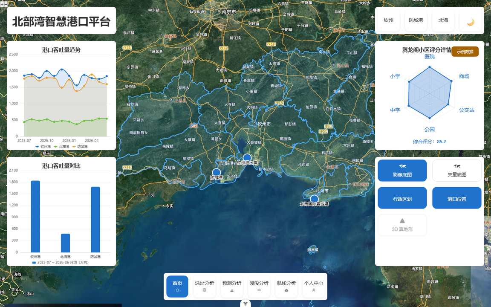
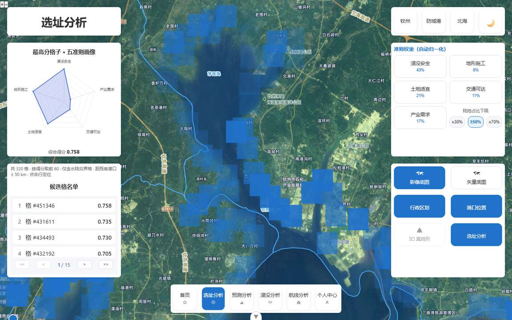
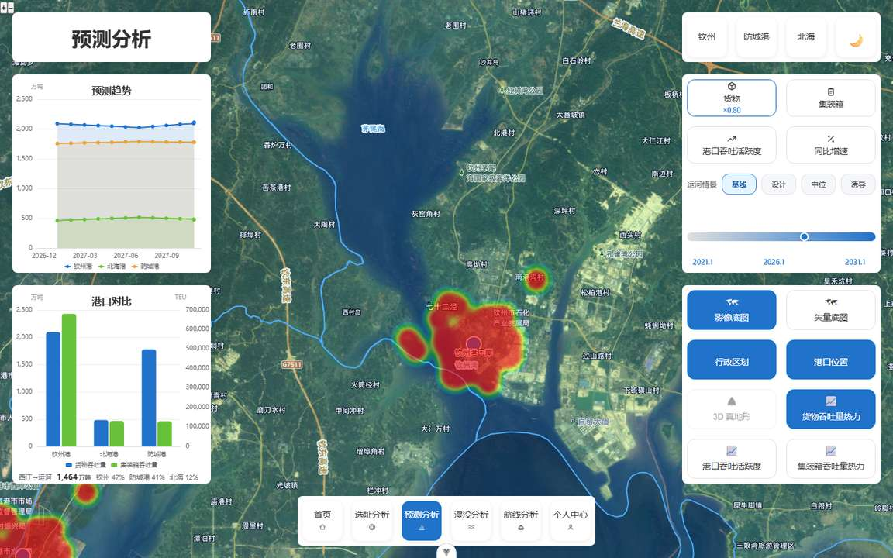

# 北部湾智慧港口 WebGIS

面向港口运营与规划决策的 WebGIS 系统：二维（OpenLayers）/ 三维（Cesium）双引擎，Vue 3 + NestJS + PostGIS。

围绕平陆运河通航后的港口能力问题，系统回答四件事：**新港区选在哪里**（多因子选址）、**吞吐量还能撑几年**（时间序列预测）、**不同水位淹到哪里**（洪涝分析）、**船怎么走**（三维航线规划）。

## 界面

| 总览 | 港址适宜性 |
| --- | --- |
|  |  |



## 功能模块

| 路由 | 模块 | 能力 |
| --- | --- | --- |
| `/` | 总览 | 港口吞吐量概览、雷达对比、图层开关 |
| `/site-suitability` | 港址适宜性 | AHP 层次分析 + 多因子加权，水陆约束与距港上限，输出适宜性分级与候选格 |
| `/forecast` | 吞吐量预测 | 时间序列 / 指数平滑 / 灰色预测，置信区间、同比增速、运河分流份额 |
| `/flood-analysis` | 洪涝分析 | 水位～淹没范围、设施受损、地形剖面 |
| `/route-analysis` | 航线分析 | 三维航线规划、相机沿路径取景、通视分析 |

## 技术栈

- 前端：Vue 3、Pinia、Element Plus、ECharts、OpenLayers、Cesium
- 后端：NestJS、TypeORM、PostGIS（PostgreSQL 16 + pgRouting）
- 部署：Docker Compose + nginx

## 目录

```
frontend/      前端（src、public；依赖与脚本由仓库根 package.json 管理）
backend/       NestJS 后端（src、test、data 样例数据、static 元数据）
database/      PostGIS 建表与视图 SQL（按文件名序号执行）
data/          数据来源、口径与假设登记（见 data/README.md）
docs/          界面截图
deploy/        Dockerfile / docker-compose.yml / nginx.conf
```

## 快速开始

环境要求：Node.js ≥ 20、npm ≥ 10；跑数据库需要 Docker。

### 1. 安装依赖

```bash
npm install --registry=https://registry.npmmirror.com                  # 前端与根脚本
npm --prefix backend install --registry=https://registry.npmmirror.com # 后端
```

### 2. 配置环境变量

后端不内置 dotenv，变量从进程环境读取；模板见 `backend/.env.example`：

```bash
cp backend/.env.example backend/.env
```

| 变量 | 必填 | 说明 |
| --- | --- | --- |
| `JWT_SECRET` | 是 | 登录令牌签名密钥，**至少 32 字符**（`openssl rand -hex 32`） |
| `PG_HOST` / `PG_PORT` / `PG_USER` / `PG_PASSWORD` / `PG_DATABASE` | 是 | 数据库连接；本地开发填 `127.0.0.1`、`5434`、`postgres`、`beibu-gulf-data` |
| `PORT` | 否 | 后端端口，默认 3000 |

`deploy/.env` 只需 `POSTGRES_PASSWORD`（与 `backend/.env` 里的 `PG_PASSWORD` 保持一致）。

前端底图需要天地图 key：在 `frontend/.env.local` 写 `VITE_TIANDITU_KEY=<your key>`。不配也能启动，只是底图为空。

### 3. 启动数据库并建表

compose 强制注入数据库口令（不提供默认值），先写 `deploy/.env`：

```bash
printf 'POSTGRES_PASSWORD=%s\n' "$(openssl rand -hex 16)" > deploy/.env

# 本地开发叠加 docker-compose.local.yml：数据库端口发布到 127.0.0.1:5434（避开本机既有的 5432）
COMPOSE="docker compose -f deploy/docker-compose.yml -f deploy/docker-compose.local.yml"
$COMPOSE up -d postgis

# 建表：按序号执行 database/0*.sql（幂等，可重复跑）
for f in database/0*.sql; do
  $COMPOSE exec -T postgis psql -U postgres -d beibu-gulf-data -v ON_ERROR_STOP=1 < "$f"
done
```

> `0*.sql` 只建表与视图，**不含业务数据**。`database/optional/` 里是依赖具体数据集的运维脚本（路网索引、回填、运河线），等对应数据入库后再按需执行；业务数据的导入脚本与源资产未随仓分发，缺数据时页面仍可打开，对应图层为空。详见「数据与资产」。

### 4. 启动

```bash
# 后端：显式导出 .env（不内置 dotenv）
set -a; . ./backend/.env; set +a
npm --prefix backend run build
npm --prefix backend run start:prod     # http://localhost:3000

# 前端（另开一个终端）
npm run dev                             # http://localhost:5173，/nest-api 代理到 3000
```

### 5. 测试与构建

```bash
npm test                            # 前端单测：173 文件 / 1205 例
npm run typecheck                   # vue-tsc
npm --prefix backend test           # 后端单测：60 文件 / 603 例（需库的套件自动跳过）
npm --prefix backend run build      # 后端编译
npm run build                       # 前端生产构建
```

## 部署

```bash
cp backend/.env.example backend/.env   # 填 JWT_SECRET 与数据库口令
docker compose -f deploy/docker-compose.yml up -d --build
```

compose 会起 PostGIS、NestJS、nginx 三个容器；nginx 对外提供前端静态文件与 `/nest-api` 反向代理。生产环境请改默认口令，并只暴露 nginx 端口。

## 数据与资产

- `backend/data/forecast/`：吞吐量历史与模型产物（公开公报衍生序列，含来源标注）。
- `backend/data/flood/`：设施点位、水位基准、地形剖面等 JSON。
- `backend/data/planning/`：规划港区采集件（3 个港区代表点、6 个法定锚点，含来源与待核标记）。
- 数据来源、口径与假设登记见 `data/README.md`。

**未随仓的大体积资产**：DEM 栅格（约 51MB）、`flood_levels.json.gz`（约 18MB）、倾斜摄影 / 影像瓦片本体（数百 MB）。仓内只保留 `tileset.json` 等元数据索引用于校验加载逻辑；缺资产时三维与洪涝图层退化为空。

## 已知限制

- 无数据库数据时，选址接口返回 0 个候选格（页面正常，图表为空）。
- 三维底图依赖天地图 key；瓦片服务不可达时地图退化为纯色底。
- 航线规划依赖路网数据（pgRouting），未导入路网时该页返回空结果。
- 本项目为研究性系统：预测与评分是模型输出，不构成港区规划结论。

## 贡献与问题

欢迎提 Issue 与 PR。提交前请至少跑通 `npm test`、`npm --prefix backend test`、`npm run typecheck`。

## 许可

MIT，见 `LICENSE`。
